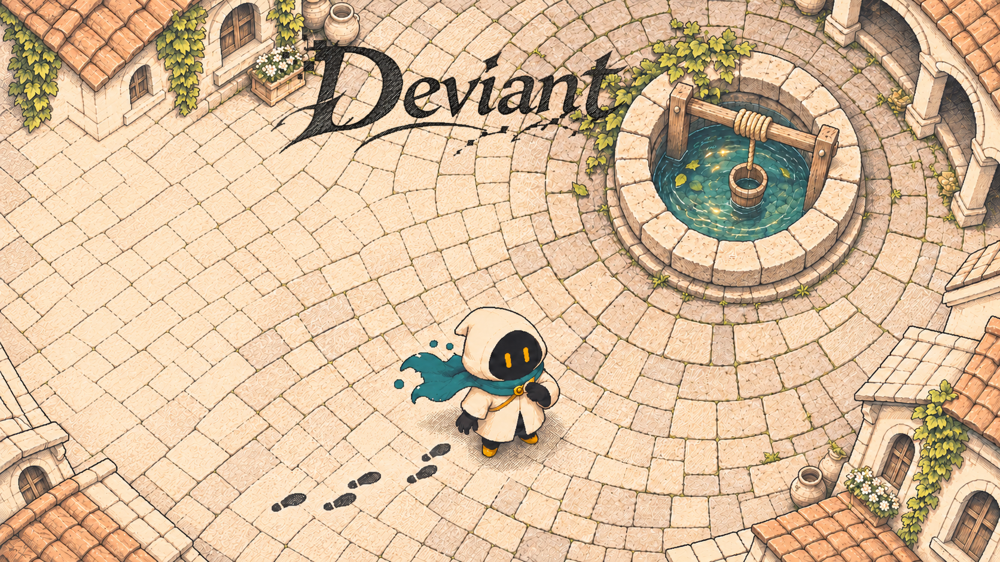
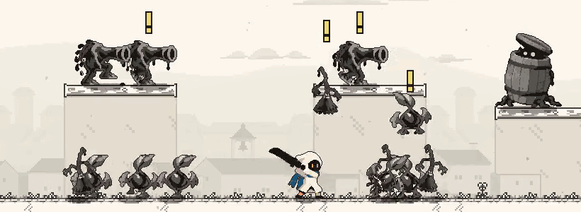
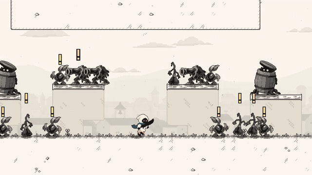
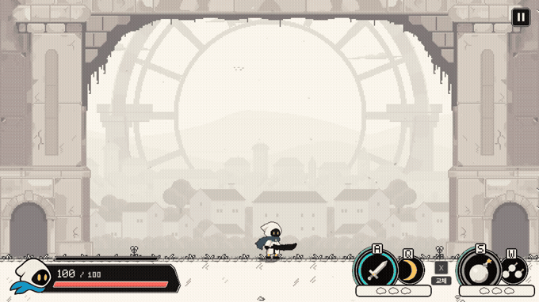

# DEVIANT

## 실제 동작 영상

전투와 이동 플레이를 보여주는 실제 프로젝트 녹화입니다. (약 10초, 무음)

https://github.com/user-attachments/assets/b2e45379-9eb7-4a49-8765-984b87fd6cd3

움직이는 GIF 미리보기

[MP4 파일 다운로드](https://raw.githubusercontent.com/Seogaeun03/deviant/main/assets/demo.mp4)

잉크와 스케치 분위기의 **Unity 2D 액션 로그라이트**입니다. 팀 프로젝트의 게임 코드, 씬, 설정과 공개 가능한 제작 자료를 정리한 저장소입니다.

## 시계탑 집행자 등장

Unity에서 보스 등장 장면을 실행해 등장 연출과 체력 바가 표시되는 순간을 녹화했습니다.

[녹화 원본 보기 (MP4)](https://raw.githubusercontent.com/Seogaeun03/deviant/main/assets/service-tour.mp4)

## 주요 내용

- 무기별 공격과 스킬, 적, 보스 전투
- 전투 HUD와 인벤토리, 제작, 장착 흐름
- 스테이지, 맵, 튜토리얼과 게임 데이터
- 리소스 검사와 제작 보조 도구

| 코드 영역 | 위치 |
|---|---|
| 공통 게임, 전투, UI 구현 | [unity/Assets/Deviant](unity/Assets/Deviant) |
| 공통 전투 실행, 테스트 | [unity/Assets/ForestCombatV2](unity/Assets/ForestCombatV2) |
| 챕터 자료 | [unity/Assets/Chapter2](unity/Assets/Chapter2) |
| 제작, 검사 도구 | [tools](tools) |
| 게임 데이터 | [data](data) |

## 서가은의 역할

- 직접 플레이하며 전투 체감과 화면, 조작의 문제를 찾고 수정 기준을 정했습니다.
- HTML 프로토타입으로 제작, 장착 순서와 조작 피드백을 비교한 뒤 Unity 반영을 검수했습니다.
- 프로토타입과 실제 엔진의 공격 타이밍 차이를 추적하고 카메라, 피격 반응의 방향을 구체화했습니다.
- HUD 픽셀 표현과 아이콘 식별성, 리소스 검수와 발표 구성에 참여했습니다.

AI와 구현을 협업했으며, 저는 방향 설정과 비교, 검수를 맡았습니다. 잉크, 파츠 시스템 원안과 팀원 이펙트 등은 팀 기여로 구분합니다. [대표 문제 해결 사례](docs/CASE_STUDY.md)를 참고하세요.

## 개발 환경

- Unity **6000.6.5f1** — [ProjectVersion.txt](unity/ProjectSettings/ProjectVersion.txt) 기준
- C# 게임 코드와 Python 기반 데이터, 제작 보조 도구
- 빌드 대상에 맞는 Unity 플랫폼 모듈

## 실행 준비

1. 저장소를 받은 뒤 Unity Hub에서 `unity` 폴더를 프로젝트로 추가합니다.
2. 아래 공개 제외 리소스를 확인하고, 사용 권한이 있는 자료로 준비합니다.
3. 지정 버전의 Unity에서 패키지를 임포트하고 Console과 씬 참조를 확인합니다.
4. 공통 타이틀 씬 `Assets/ForestCombatV2/Scenes/Chapter1Title.unity`에서 실행 흐름을 확인합니다.

### 원래 화면을 재현할 때 필요한 자료

맑은 고딕, Arial을 포함한 폰트와 폰트 아틀라스, 재배포 권리가 확인되지 않은 외부 VFX 패키지, 음원은 공개하지 않았습니다. 따라서 **이 공개본만으로 원래 게임 화면, 효과, 음원을 완전히 재현할 수는 없습니다.** 누락 리소스의 참조, 대체는 권한이 있는 파일을 사용해 맞춰야 합니다.

팀의 비공개 리소스 서버를 공개 사용자에게 연결하거나 접근 키를 제공하지 않습니다. 코드를 검토할 때는 위 영역별 링크를 이용할 수 있습니다.

## 공개 범위

게임 코드와 공개 가능한 리소스를 포함하며, 내부 작업 기록, 보존 원문, 운영 자료와 권리 확인이 되지 않은 외부 자료는 제외했습니다. 팀 원본은 별도로 비공개 보관합니다.

[공개 범위](PUBLIC_SCOPE.md) / [외부 자료 고지](THIRD_PARTY_NOTICES.md)
